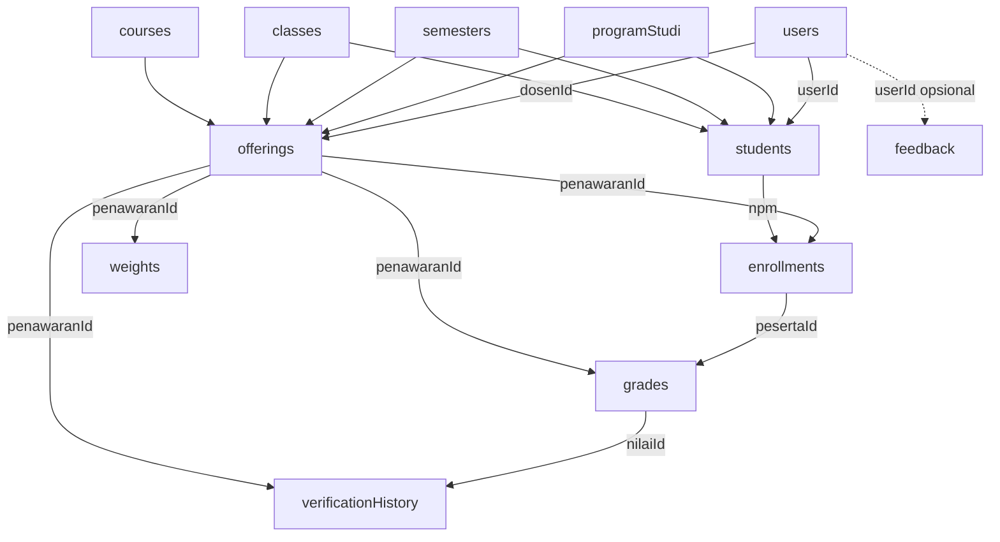

# Rancangan Basis Data NoSQL — SIMANIS UHM

Dokumen ini adalah rancangan data untuk **Cloud Firestore**. Firestore bersifat
NoSQL berbasis dokumen, sehingga rancangan ini tidak menggunakan tabel,
foreign key, atau join seperti ERD relasional. Hubungan antardata disimpan
melalui ID referensi dan dirangkai oleh aplikasi.

## Prinsip rancangan

- Satu collection mewakili satu kelompok dokumen sejenis.
- Setiap dokumen memiliki field `id` yang sama dengan ID dokumen Firestore.
- Relasi disimpan sebagai string ID, misalnya `dosenId`, `penawaranId`, dan
  `pesertaId`; Firestore tidak memvalidasi foreign key secara otomatis.
- Data master tidak diduplikasi ke dokumen transaksi. Nama mahasiswa, mata
  kuliah, dan dosen ditampilkan aplikasi dengan mencari dokumen referensinya.
- Data yang sering berubah bersama nilai, yaitu komponen nilai dan status
  verifikasi, disimpan dalam satu dokumen `grades`.
- Feedback disimpan sebagai dokumen mandiri agar dapat dikirim pengunjung tanpa
  bergantung pada akun.

## Peta hubungan konseptual



Panah adalah referensi logis dalam dokumen, bukan constraint database. Contoh:
`grades.pesertaId` harus merujuk ke `enrollments.id`, tetapi pemeriksaan itu
dilakukan oleh aplikasi dan Firestore Rules/Cloud Functions bila sistem kelak
diamankan.

## Collection dan dokumen

### 1. `users`

Menyimpan akun aplikasi dan perannya.

```js
// users/{userId}
{
  id: "usr-dsn-01",
  name: "Dr. Andi Pengampu, S.Kom., M.Kom.",
  username: "dosen01",
  email: "dosen01@uhm.ac.id",
  role: "dosen", // admin | dosen | mahasiswa
  isActive: true,
  avatar: "AP", // opsional
  nidn: "0123456789", // khusus dosen, opsional
  npm: null, // khusus mahasiswa bila digunakan
  prodiId: "prodi-s2-rpl", // opsional
  createdAt: "2026-01-10T08:00:00.000Z",
  demoPassword: "Demo2026!" // hanya data demonstrasi, jangan dipakai produksi
}
```

**Referensi keluar:** `prodiId` → `programStudi.id`.

### 2. `programStudi`

Master program studi.

```js
// programStudi/{prodiId}
{
  id: "prodi-s2-rpl",
  kodeProdi: "S2-SK",
  namaProdi: "Magister Pascasarjana Prodi Sistem Komputer",
  jenjang: "S2" // S1 | S2 | D3
}
```

### 3. `semesters`

Master semester paket akademik.

```js
// semesters/{semesterId}
{
  id: "sem-1",
  nomorSemester: 1,
  namaSemester: "Semester 1"
}
```

### 4. `classes`

Master kelas asal mahasiswa dan kelas penawaran.

```js
// classes/{kelasId}
{
  id: "kls-pasca-1",
  kodeKelas: "PASCA-1",
  namaKelas: "Pascasarjana 1",
  prodiId: "prodi-s2-rpl"
}
```

**Referensi keluar:** `prodiId` → `programStudi.id`.

### 5. `courses`

Master mata kuliah.

```js
// courses/{courseId}
{
  id: "mk-rpl701",
  kodeMK: "RPL701",
  namaMK: "Sistem Komputer",
  sks: 3,
  semesterPaket: 1,
  deskripsi: "Deskripsi mata kuliah" // opsional
}
```

### 6. `offerings`

Dokumen inti perkuliahan: satu mata kuliah yang dibuka untuk satu kelas, satu
periode, dan satu dosen pengampu.

```js
// offerings/{penawaranId}
{
  id: "pnw-rpl-pasca-1",
  mataKuliahId: "mk-rpl701",
  prodiId: "prodi-s2-rpl",
  semesterId: "sem-1",
  kelasId: "kls-pasca-1",
  dosenId: "usr-dsn-01",
  periodeAkademik: "2026/2027 — Ganjil",
  ruang: "Lab Komputer 1", // opsional
  jadwal: "Senin, 08:00 - 10:30 WITA", // opsional
  statusPublikasi: "published" // draft | published
}
```

**Referensi keluar:** `mataKuliahId`, `prodiId`, `semesterId`, `kelasId`, dan
`dosenId` masing-masing merujuk ke collection master yang sesuai.

### 7. `students`

Profil akademik mahasiswa. Dokumen ini dipisahkan dari `users` karena menyimpan
atribut akademik dan dapat dicari dengan NPM.

```js
// students/{studentId}
{
  id: "mhs-9900000001",
  userId: "usr-mhs-01",
  npm: "9900000001",
  nama: "Nama Mahasiswa",
  email: "9900000001@uhm.ac.id",
  prodiId: "prodi-s2-rpl",
  semesterId: "sem-1",
  kelasAsalId: "kls-pasca-1", // opsional
  angkatan: "2026"
}
```

**Referensi keluar:** `userId` → `users.id`; `prodiId`, `semesterId`, dan
`kelasAsalId` mengarah ke master terkait.

### 8. `enrollments`

Pendaftaran mahasiswa pada kelas penawaran. Satu dokumen mewakili satu
mahasiswa pada satu `offering`.

```js
// enrollments/{pesertaId}
{
  id: "pst-rpl-9900000001",
  penawaranId: "pnw-rpl-pasca-1",
  npm: "9900000001",
  createdAt: "2026-02-01T08:00:00.000Z"
}
```

**Aturan integritas aplikasi:** kombinasi `penawaranId + npm` harus unik.

### 9. `weights`

Konfigurasi bobot satu kelas penawaran. Satu penawaran seharusnya memiliki satu
dokumen bobot.

```js
// weights/{weightId}
{
  id: "bbt-rpl-pasca-1",
  penawaranId: "pnw-rpl-pasca-1",
  bobotTugas: 30,
  bobotUTS: 30,
  bobotUAS: 40,
  updatedAt: "2026-03-01T08:00:00.000Z"
}
```

**Aturan integritas aplikasi:** `bobotTugas + bobotUTS + bobotUAS = 100`.
Bobot dapat diperbarui oleh dosen pengampu atau administrator. Nilai akhir
dihitung ulang aplikasi dari bobot terbaru; nilai mentah mahasiswa tidak diubah.

### 10. `grades`

Nilai seorang peserta pada satu penawaran. Komponen nilai, status verifikasi,
dan siklus permintaan revisi disimpan bersama agar pembaruan bersifat atomik
per mahasiswa.

```js
// grades/{nilaiId}
{
  id: "nil-rpl-9900000001",
  pesertaId: "pst-rpl-9900000001",
  penawaranId: "pnw-rpl-pasca-1",
  npm: "9900000001",
  nilaiTugas: 85, // number | null
  nilaiUTS: 80, // number | null
  nilaiUAS: 90, // number | null
  statusVerifikasi: "Terverifikasi",
  statusPermintaanRevisi: null,
  alasanPermintaanRevisi: null,
  dimintaOleh: null,
  dimintaPada: null,
  diputuskanOleh: null,
  diputuskanPada: null,
  catatanKeputusan: null,
  nilaiSebelumRevisi: null,
  verifiedBy: "usr-dsn-01",
  verifiedAt: "2026-04-01T08:00:00.000Z",
  updatedAt: "2026-04-01T08:00:00.000Z"
}
```

Nilai akhir dan huruf mutu **tidak disimpan** dalam dokumen ini. Aplikasi
menghitung keduanya dari tiga komponen nilai dan dokumen `weights` agar hasil
selalu mengikuti bobot terbaru.

**Aturan integritas aplikasi:** satu `enrollments.id` hanya boleh memiliki satu
`grades.pesertaId`; setiap nilai komponen berada pada rentang 0–100.

### 11. `verificationHistory`

Audit log tindakan nilai. Tidak dipakai sebagai sumber nilai aktif; dokumen ini
menyimpan jejak verifikasi, pengajuan revisi, persetujuan, penolakan, dan
koreksi nilai.

```js
// verificationHistory/{historyId}
{
  id: "rwy-001",
  nilaiId: "nil-rpl-9900000001",
  penawaranId: "pnw-rpl-pasca-1",
  npm: "9900000001",
  aksi: "Verifikasi",
  userId: "usr-dsn-01",
  userName: "Dr. Andi Pengampu, S.Kom., M.Kom.",
  waktu: "2026-04-01T08:00:00.000Z",
  keterangan: "Verifikasi nilai akhir mahasiswa berhasil dilakukan.",
  nilaiSebelum: null,
  nilaiSesudah: { tugas: 85, uts: 80, uas: 90 }
}
```

### 12. `feedback`

Masukan pengguna sistem dan pengunjung. Collection muncul otomatis setelah
feedback pertama berhasil dibuat.

```js
// feedback/{feedbackId}
{
  id: "fb-1770000000000",
  nama: "Nama Pengirim",
  email: "pengirim@example.com",
  role: "pengunjung", // dosen | mahasiswa | pengunjung
  userId: null, // terisi untuk dosen/mahasiswa yang login
  ratingTampilan: 5,
  ratingNavigasi: 4,
  ratingKenyamanan: 4,
  saran: "Tambahkan fitur ...",
  createdAt: "2026-11-15T08:00:00.000Z"
}
```

Feedback hanya dibuat oleh dosen, mahasiswa, atau pengunjung. Halaman admin
membaca seluruh dokumen feedback dan mengurutkannya dari kiriman terbaru.

## Status dan enumerasi

| Field | Nilai yang diizinkan |
|---|---|
| `users.role` | `admin`, `dosen`, `mahasiswa` |
| `offerings.statusPublikasi` | `draft`, `published` |
| `grades.statusVerifikasi` | `Belum Diisi`, `Belum Lengkap`, `Menunggu Verifikasi`, `Terverifikasi` |
| `grades.statusPermintaanRevisi` | tidak ada, `Menunggu Persetujuan`, `Diizinkan Revisi`, `Ditolak` |
| `verificationHistory.aksi` | `Verifikasi`, `Batal Verifikasi`, `Koreksi Nilai`, `Permintaan Revisi`, `Persetujuan Revisi`, `Penolakan Revisi` |
| `feedback.role` | `dosen`, `mahasiswa`, `pengunjung` |

## Pola akses dan indeks

Implementasi saat ini berlangganan collection lalu melakukan penyaringan di
klien. Karena itu, query Firestore kompleks belum diperlukan untuk tampilan
saat ini. Jika data bertambah besar, pindahkan filter ke query Firestore dan
buat indeks komposit berikut bila diperlukan:

| Kebutuhan masa depan | Filter/urutan | Indeks yang direkomendasikan |
|---|---|---|
| Nilai per kelas | `grades.penawaranId`, urut `updatedAt` | `penawaranId ASC, updatedAt DESC` |
| Peserta per kelas | `enrollments.penawaranId`, urut `createdAt` | `penawaranId ASC, createdAt DESC` |
| Audit per kelas | `verificationHistory.penawaranId`, urut `waktu` | `penawaranId ASC, waktu DESC` |
| Feedback admin | urut `createdAt` | `createdAt DESC` |
| Mata kuliah dosen | `offerings.dosenId`, urut periode | `dosenId ASC, periodeAkademik DESC` |

Firestore akan memberi tautan pembuatan indeks apabila sebuah query komposit
belum memiliki indeks yang diperlukan.

## Integritas dan keamanan

Firestore tidak menjalankan cascade delete atau foreign key. Aplikasi saat ini
menjaga sebagian integritas, contohnya menolak penghapusan mahasiswa/penawaran
yang masih memiliki nilai terverifikasi dan mencegah pendaftaran ganda.

Untuk penggunaan produksi, terapkan Firebase Authentication dan Firestore Rules
berbasis `request.auth`, validasi role, serta validasi isi dokumen. Login saat
ini masih mode demonstrasi berbasis collection `users`, sehingga pembatasan role
di antarmuka belum merupakan pengamanan server.

## Ringkasan perbedaan dengan ERD relasional

| ERD relasional | Rancangan Firestore SIMANIS |
|---|---|
| Tabel dan baris | Collection dan dokumen |
| Primary key / foreign key | ID dokumen dan field referensi string |
| Join SQL | Resolusi referensi di aplikasi atau denormalisasi terkontrol |
| Constraint database | Validasi aplikasi, Firestore Rules, dan Cloud Functions bila diperlukan |
| Tabel relasi many-to-many | Collection transaksi `enrollments` |
| Trigger/audit | Penulisan dokumen `verificationHistory` oleh aplikasi/server |
