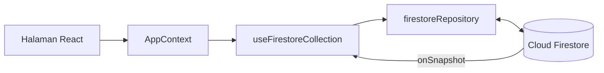

# PROJECT PENGEMBANGAN REKAYASA PERANGKAT LUNAK APLIKASI PENGOLAHAN NILAI MAHASISWA

## SIMANIS UHM

**Sistem Informasi Manajemen Nilai Mahasiswa Universitas Handayani Makassar**

1. **Mahabintang Pallawabonang (2026130027)**
2. **Nur Azizah Arafah (2026130021)**

SIMANIS UHM adalah Sistem Informasi Manajemen Nilai Mahasiswa untuk Universitas Handayani Makassar. Aplikasi ini membantu administrator mengelola data akademik, dosen mengolah dan memverifikasi nilai, serta mahasiswa melihat dan mencetak daftar nilainya.

Project ini dikembangkan untuk **tugas dan demonstrasi**. Data contoh dan cara login saat ini belum memberikan perlindungan yang memadai untuk data akademik atau akun nyata.

## Teknologi

- React dan TypeScript untuk antarmuka aplikasi.
- Vite sebagai server pengembangan dan pembuat build.
- Tailwind CSS dan Lucide React untuk tampilan dan ikon.
- Cloud Firestore melalui Firebase Web SDK untuk penyimpanan data.
- Node.js dan npm untuk menjalankan project.

## Peran dan fitur

| Peran | Fitur yang tersedia |
|---|---|
| Administrator | Dashboard ringkasan, pengelolaan mahasiswa, mata kuliah, akun dosen, penawaran kelas, peserta, dan keputusan permintaan revisi nilai. |
| Dosen | Melihat mata kuliah yang diampu, mengatur bobot, memasukkan Tugas/UTS/UAS, memverifikasi nilai, serta meminta revisi nilai terverifikasi. |
| Mahasiswa | Dashboard studi, grafik dan rata-rata nilai, daftar nilai, cetak daftar nilai, serta profil. |

Menu yang terlihat mengikuti role akun di aplikasi. Administrator memberikan keputusan atas permintaan revisi; pengolahan nilai dilakukan oleh dosen pengampu.

## Alur akademik dan penilaian

1. Administrator mengelola mata kuliah, kelas penawaran, dosen pengampu, dan peserta.
2. Dosen membuka kelas yang diampu, mengatur bobot Tugas, UTS, dan UAS hingga totalnya 100%, lalu mengisi nilai mahasiswa dalam rentang 0–100.
3. Nilai yang komponennya lengkap dapat diverifikasi dosen. Bobot dikunci pada tampilan ketika terdapat nilai terverifikasi di kelas tersebut.
4. Jika nilai terverifikasi perlu diperbaiki, dosen mengajukan permintaan revisi beserta alasan. Administrator menyetujui atau menolak; dosen kemudian melakukan perubahan dan verifikasi kembali sesuai statusnya.
5. Mahasiswa melihat nilai pada dashboard dan **Daftar Nilai Saya**. Nilai lengkap yang belum diverifikasi ditampilkan sebagai nilai sementara. Daftar nilai dapat dicetak meskipun ada nilai yang belum lengkap atau belum diverifikasi.

Nilai akhir dihitung dari kontribusi masing-masing komponen sesuai bobot. Pada rata-rata mahasiswa, setiap mata kuliah yang diikuti menjadi pembagi; mata kuliah yang nilai akhirnya belum dapat dihitung ditampilkan dengan `-` dan dihitung sebagai **0**. Tidak ada rata-rata jika mahasiswa belum mengikuti mata kuliah.

## Program studi dan kelas

Data yang disiapkan pada Firestore menggunakan nama program studi **Magister Pascasarjana Prodi Sistem Komputer**. Kelas tersedia dengan kode `PASCA-1`, `PASCA-2`, `PASCA-3`, dan `PASCA-4`. Kelas yang sebelumnya bernama RPL-A menjadi PASCA-1; peserta tidak dipindahkan secara otomatis ke kelas lain.

Mata kuliah berkode `RPL701` menggunakan nama **Sistem Komputer**. Kode mata kuliah saat ini tetap `RPL701`.

## Cetak Kartu Hasil Studi

Mahasiswa dapat membuka menu **Daftar Nilai Saya**, lalu memilih **Cetak Daftar Nilai**. Dokumen menggunakan kop surat dan logo Universitas Handayani Makassar, identitas mahasiswa, tahun akademik, semester, serta kelas dari data yang tersedia di Firestore.

Tabel cetak memuat nomor, kode mata kuliah, nama mata kuliah, nama dosen, dan nilai huruf. Di bawah tabel terdapat **Ringkasan Rata-rata Nilai** dalam persen dan ruang tanda tangan ketua program studi. Kolom SKS, nilai akhir angka, dan status tidak ditampilkan pada tabel cetak.

Dokumen tetap dapat dicetak saat nilai belum lengkap atau belum diverifikasi. Nilai lengkap yang belum diverifikasi termasuk dalam perhitungan sebagai nilai sementara; mata kuliah tanpa nilai akhir yang dapat dihitung tetap dihitung sebagai 0 dalam rata-rata.

## Alur data Firestore



`src/lib/firebase.ts` membaca konfigurasi Web Firebase dari environment variable. `AppContext` memakai `useFirestoreCollection` untuk berlangganan perubahan tiap collection melalui `onSnapshot`. Perubahan state dikirim melalui `firestoreRepository` dalam batch per collection. Kegagalan akses atau penyimpanan ditampilkan oleh aplikasi.

Collection utama yang dipakai:

| Collection | Isi |
|---|---|
| `users` | Profil akun, username, role, status aktif, dan password demonstrasi jika tersedia. |
| `programStudi`, `semesters`, `classes` | Data referensi program studi, semester, dan kelas. |
| `courses`, `offerings` | Mata kuliah dan penawarannya, termasuk dosen pengampu. |
| `students`, `enrollments` | Profil mahasiswa dan pendaftaran ke penawaran mata kuliah. |
| `weights`, `grades` | Bobot penilaian dan komponen serta status nilai. |
| `verificationHistory` | Riwayat tindakan verifikasi dan revisi. |

Pemetaan field tersedia di [firestore.schema.md](firestore.schema.md). Firestore membuat collection ketika dokumen pertama ditulis; Firestore Rules mengatur akses ke dokumen, bukan membuat collection. Operasi yang melibatkan beberapa collection saat ini belum dibungkus dalam satu transaksi lintas collection.

## Akun contoh

Data contoh yang pernah disiapkan untuk project ini menggunakan akun berikut, selama dokumennya belum diubah di Firestore:

| Peran | Username | Password contoh |
|---|---|---|
| Admin | `admin` | `Demo2026!` |
| Dosen | `dosen01`–`dosen05` | `Demo2026!` |
| Mahasiswa | `9900000001`–`9900000030` | `Demo2026!` |

Untuk pemeriksaan daftar nilai, akun `9900000001`–`9900000003` disiapkan dengan nilai lengkap pada seluruh mata kuliah; `9900000004`–`9900000006` memiliki sebagian nilai lengkap; dan `9900000007`–`9900000009` belum memiliki nilai lengkap. Kondisi ini dapat berubah ketika data diedit melalui aplikasi.

## Menjalankan di komputer lokal

**Prasyarat:** Node.js `20.19+` pada seri 20, atau `22.12+`, npm, dan project Firebase dengan Cloud Firestore.

1. Buka terminal pada folder project dan jalankan:

   ```bash
   npm install
   ```

2. Salin `.env.example` menjadi `.env.local`. Di Firebase Console, buka **Project settings → General → Your apps**, lalu ambil konfigurasi aplikasi Web dan isi variabel berikut:

   ```env
   VITE_FIREBASE_API_KEY="..."
   VITE_FIREBASE_AUTH_DOMAIN="..."
   VITE_FIREBASE_PROJECT_ID="..."
   VITE_FIREBASE_STORAGE_BUCKET="..."
   VITE_FIREBASE_MESSAGING_SENDER_ID="..."
   VITE_FIREBASE_APP_ID="..."
   ```

3. Jalankan `npm run dev`, lalu buka alamat yang ditampilkan di terminal. Mulai ulang server jika `.env.local` diubah.
4. Pada database kosong, aplikasi menyediakan tombol untuk membuat akun administrator contoh dan data dasar program studi, semester, serta kelas. Data nilai dan mahasiswa lain tidak diisi otomatis melalui tombol tersebut.

Perintah lain:

```bash
npm run lint     # pemeriksaan TypeScript
npm test         # tes perhitungan nilai dan alur role
npm run build    # build produksi ke folder dist
npm run preview  # melihat build lokal
```

`npm run seed:demo` adalah skrip pengisian data contoh untuk project yang dikonfigurasi di skrip. Skrip memeriksa benturan ID dan tidak dimaksudkan sebagai migrasi umum atau perintah reset database. Jangan menjalankannya pada database berisi data nyata.

## Menjalankan di Vercel

Impor project ke Vercel dengan preset Vite. Build menggunakan `npm run build` dan hasilnya berada di `dist`. Tambahkan enam variabel `VITE_FIREBASE_*` yang sama pada **Project Settings → Environment Variables**, sesuai environment deployment, lalu deploy ulang.

Variabel `VITE_*` dimasukkan ke kode browser saat build. Konfigurasi Web Firebase bukan tempat untuk menyimpan kunci privat atau service account. Jangan memasukkan service account JSON atau rahasia server ke variabel `VITE_*`.

## UI dan UX

Antarmuka menggunakan warna biru, kartu transparan, dan navigasi yang menyesuaikan desktop serta ponsel. Dashboard menampilkan ringkasan dan grafik dari data Firestore yang sedang diikuti. Navigasi halaman, kartu dashboard, dan latar login memiliki animasi halus; animasi mengikuti pengaturan **reduce motion** pada perangkat. Tampilan cetak disiapkan terpisah agar daftar nilai dapat dicetak dari browser.

## Batasan keamanan dan operasional

- Aplikasi **tidak memakai Firebase Authentication**. Login mencocokkan akun yang dibaca dari Firestore di sisi browser. Password demonstrasi pada field `demoPassword` dapat terbaca, dan akun tanpa field tersebut tidak diperiksa password-nya. Kontrol role di antarmuka bukan pengamanan server.
- Aturan Firestore terbuka untuk demonstrasi memungkinkan pihak lain membaca atau mengubah data. Gunakan hanya data fiktif; jangan gunakan password sebenarnya, NPM asli, atau nilai akademik nyata.
- File lokal [firestore.rules](firestore.rules) menolak semua akses, sedangkan Rules yang dipublikasikan secara manual di Firebase Console dapat berbeda. Deploy Rules dengan Firebase CLI akan menimpa aturan di Console. Periksa juga tanggal kedaluwarsa Rules sementara di Console.
- Sebelum penggunaan nyata, diperlukan identitas dan otorisasi yang tepercaya, pengelolaan password yang aman di server, Rules sesuai role, dan pengujian menyeluruh alur serta integritas data.

## Struktur project

```text
src/
  components/layout/    Navigasi dan tata letak
  components/pages/     Halaman admin, dosen, dan mahasiswa
  context/AppContext.tsx State aplikasi dan operasi akademik
  data/initialData.ts   Data contoh lokal
  lib/                  Konfigurasi dan akses Firestore
  types/                Tipe data aplikasi
  utils/                Perhitungan nilai dan alur revisi
scripts/                Skrip data contoh dan pemeriksaan Firestore
firestore.rules         Rules lokal Firestore
firestore.indexes.json  Konfigurasi indeks Firestore
firebase.json           Konfigurasi Firebase CLI
```
