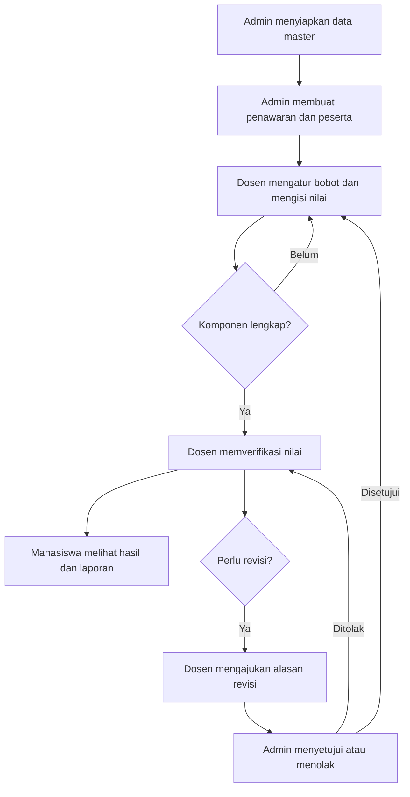
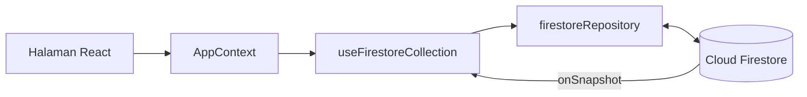
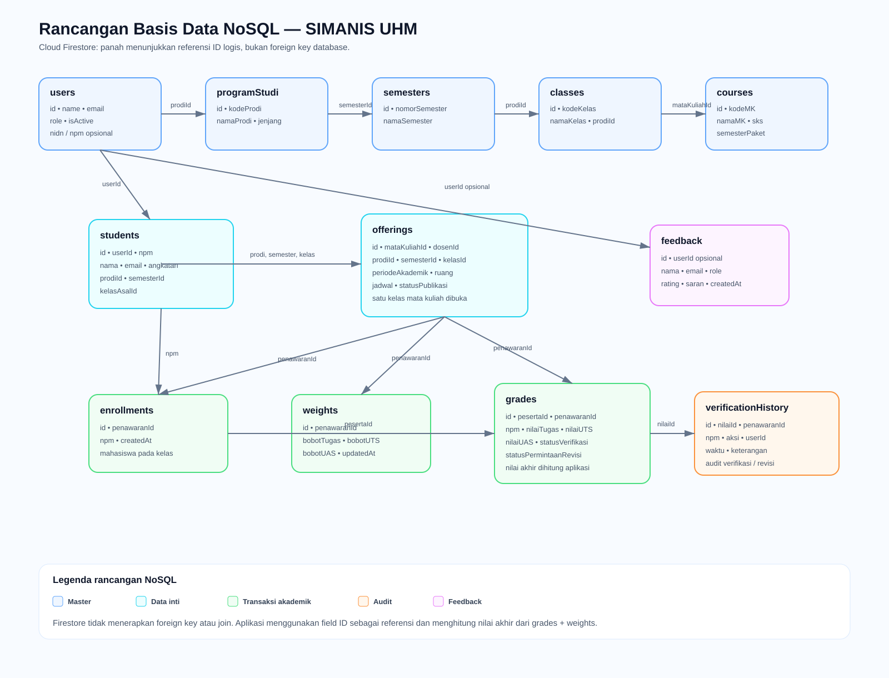

# PROJECT PENGEMBANGAN REKAYASA PERANGKAT LUNAK APLIKASI PENGOLAHAN NILAI MAHASISWA

## SIMANIS UHM

**Sistem Informasi Manajemen Nilai Mahasiswa Universitas Handayani Makassar**

1. **Mahabintang Pallawabonang (2026130027)**
2. **Nur Azizah Arafah (2026130021)**

SIMANIS UHM adalah Sistem Informasi Manajemen Nilai Mahasiswa untuk Universitas Handayani Makassar. Aplikasi ini membantu administrator mengelola data akademik, dosen mengolah dan memverifikasi nilai, serta mahasiswa melihat dan mencetak laporan nilai per mata kuliah.

Project ini dikembangkan untuk **tugas dan demonstrasi**. Data contoh dan cara login saat ini belum memberikan perlindungan yang memadai untuk data akademik atau akun nyata.

## Acuan penyusunan laporan

README ini merangkum rancangan dan implementasi yang dapat dijadikan bahan laporan kelompok maupun individu. Sesuaikan format bab, kontribusi masing-masing anggota, waktu pelaksanaan, dan hasil pengamatan dengan keadaan sebenarnya. Metode penelitian, jumlah responden, hasil kuesioner, pembagian tugas, dan kesimpulan keberhasilan tidak dapat ditentukan hanya dari kode proyek.

### Latar belakang

Pengelolaan nilai melibatkan data mahasiswa, mata kuliah, dosen pengampu, peserta kelas, komponen penilaian, serta penyampaian hasil. Ketika data tersebar, proses memasukkan, memeriksa, merevisi, dan menyajikan nilai dapat menjadi lebih sulit dilacak. SIMANIS UHM dibuat sebagai prototipe aplikasi berbasis web untuk memusatkan alur tersebut dalam satu sistem yang terhubung dengan Cloud Firestore.

### Rumusan masalah, tujuan, dan manfaat

| Pokok bahasan | Penjelasan |
|---|---|
| Rumusan masalah | Bagaimana mengelola data akademik dan penilaian dalam satu aplikasi, menyediakan antarmuka sesuai peran, serta menyajikan hasil nilai yang mudah dipahami? |
| Tujuan | Membangun aplikasi pengelolaan data akademik yang menghitung nilai, mendukung verifikasi dan revisi, menampilkan hasil studi, serta bertukar data melalui CSV/Excel. |
| Manfaat bagi administrator | Membantu pengelolaan data master, penawaran, peserta, bobot, dan keputusan revisi. |
| Manfaat bagi dosen | Membantu pengisian komponen, pemeriksaan, verifikasi, revisi, dan penyajian nilai kelas. |
| Manfaat bagi mahasiswa | Memudahkan pemantauan mata kuliah, nilai, rata-rata, dan laporan nilai pribadi. |
| Ruang lingkup | Prototipe web untuk data akademik dan penilaian; belum menyediakan pengamanan akun dan otorisasi tingkat produksi. |

### Aktor dan kebutuhan sistem

| Aktor | Kebutuhan utama | Hasil yang diharapkan |
|---|---|---|
| Administrator | Mengelola mahasiswa, mata kuliah, akun dosen, penawaran, peserta, bobot dan keputusan revisi | Data akademik siap digunakan dosen |
| Dosen pengampu | Memilih kelas, mengisi komponen, mengatur bobot, memverifikasi atau meminta revisi | Nilai kelas dihitung dan statusnya dapat ditinjau |
| Mahasiswa | Melihat dashboard, daftar nilai, profil, dan mencetak atau mengekspor hasil pribadi | Informasi studi dan hasil mata kuliah tersedia pada akun |
| Pengunjung | Mengirim feedback dari halaman login | Masukan tersimpan untuk ditinjau administrator |

Kebutuhan nonfungsional yang diterapkan meliputi tampilan responsif desktop/tablet/ponsel, akses realtime melalui listener, validasi masukan, penanganan kesalahan, dukungan keyboard pada dropdown file, dan pengurangan animasi sesuai pengaturan perangkat. Ketersediaan dan kinerja bergantung pada koneksi dan layanan Firebase; belum ada hasil pengukuran performa formal yang didokumentasikan.

### Proses bisnis utama



Mahasiswa dapat melihat nilai lengkap yang belum diverifikasi sebagai nilai sementara. Diagram menggambarkan alur umum; validasi rinci dijelaskan dalam bagian penilaian dan kode aplikasi.

### Aturan perhitungan nilai

Bobot Tugas, UTS, dan UAS masing-masing berada pada rentang 0–100 dan totalnya tepat **100%**. Komponen nilai yang diisi berada pada rentang **0–100**. Komponen kosong berbeda dari nilai 0. Apabila ketiga komponen tersedia dan bobot valid, aplikasi menghitung:

```text
Nilai akhir = (Tugas × bobot Tugas / 100)
            + (UTS × bobot UTS / 100)
            + (UAS × bobot UAS / 100)
```

Contoh: Tugas **80** berbobot **30%**, UTS **75** berbobot **30%**, dan UAS **90** berbobot **40%** menghasilkan **82,50**, dengan nilai huruf **B**. Nilai akhir dibulatkan dua angka desimal. Perubahan bobot mengubah hasil perhitungan yang ditampilkan.

| Nilai akhir setelah pembulatan | Huruf |
|---|---|
| 85,00–100,00 | A |
| 75,00–84,99 | B |
| 65,00–74,99 | C |
| 50,00–64,99 | D |
| 0,00–49,99 | E |

Status nilai adalah **Belum Diisi**, **Belum Lengkap**, **Menunggu Verifikasi**, dan **Terverifikasi**. Komponen lengkap tidak otomatis terverifikasi. Nilai terverifikasi dikunci dalam alur aplikasi sampai revisinya diizinkan administrator. Rata-rata mahasiswa adalah jumlah nilai akhir dibagi jumlah mata kuliah yang diikuti; mata kuliah tanpa nilai akhir lengkap dihitung **0**. Contoh nilai 80, 90, dan satu mata kuliah belum lengkap menghasilkan rata-rata **56,67%**. Rata-rata ini bukan IPS dan tidak dibobot berdasarkan SKS.

### Rancangan arsitektur dan data

Aplikasi menggunakan React di browser, Firebase Web SDK, dan Cloud Firestore. Konfigurasi Firebase Web dibaca saat build oleh Vite. React Context menyediakan data dan operasi untuk halaman; `onSnapshot` memperbarui tampilan ketika collection berubah. Tidak ada server aplikasi khusus untuk autentikasi dalam alur ini.

Alur data umum: pengguna melakukan tindakan → halaman memvalidasi masukan → operasi `AppContext` atau layanan dijalankan → dokumen Firestore dibaca atau ditulis → listener menerima perubahan → halaman dan ringkasan diperbarui. CRUD manual menulis per collection; beberapa tindakan lintas collection belum menggunakan satu transaksi. Impor CSV/XLSX memakai pembacaan server, pratinjau, pemeriksaan ulang, dan transaksi lintas collection.

| Relasi logis | Cara penyimpanan |
|---|---|
| Akun mahasiswa → profil mahasiswa | `students.userId` merujuk `users.id` |
| Penawaran → mata kuliah, prodi, semester, kelas, dosen | Field ID pada dokumen `offerings` |
| Peserta → penawaran dan mahasiswa | `enrollments.penawaranId` dan NPM |
| Nilai → peserta dan penawaran | `grades.pesertaId`, `penawaranId`, dan NPM |
| Bobot → penawaran | `weights.penawaranId` |
| Riwayat → nilai | `verificationHistory.nilaiId` |

Relasi tersebut merupakan referensi dokumen yang dikelola aplikasi; Firestore tidak menerapkan foreign key secara otomatis. Detail atribut dan diagram tersedia dalam [rancangan basis data](DATABASE_DESIGN.md) dan [skema Firestore](firestore.schema.md).

### Rancangan antarmuka dan interaksi

Antarmuka memakai warna biru, tipografi tegas, kartu bersudut membulat, serta ikon untuk membantu mengenali tindakan. Pada desktop/tablet navigasi utama berada di sidebar; pada ponsel tersedia navigasi bawah dan menu. Pencarian, filter, dan pagination membantu penelusuran data. Dashboard administrator menampilkan jumlah mahasiswa, dosen aktif, mata kuliah, dan kelas. Dashboard mahasiswa menyajikan mata kuliah diikuti, nilai terverifikasi, nilai belum tersedia, grafik, dan rata-rata.

Pertukaran file menyediakan pilihan format, petunjuk, pratinjau per baris, validasi, dan konfirmasi. Setelah tindakan berhasil, pop-up dengan pesan sesuai tindakan muncul sekitar tiga detik dan dapat ditutup lebih awal. Tampilan cetak menggunakan tata letak tersendiri. Animasi mengikuti pengaturan pengurangan gerakan pada perangkat.

### Strategi pengujian dan bahan dokumentasi laporan

| Aspek | Contoh yang diperiksa | Bukti yang dapat dilampirkan |
|---|---|---|
| Data master | Tambah, ubah, cari, dan validasi identitas | Tangkapan layar dan hasil uji aktual |
| Penilaian | Bobot 100%, nilai kosong, 0, dan komponen lengkap | Input, hasil hitung, dan status |
| Verifikasi dan revisi | Nilai terkunci serta permintaan keputusan revisi | Dokumentasi langkah tiap peran |
| Impor dan ekspor | CSV/XLSX valid, duplikat, kesalahan, konflik, rollback | Template, pratinjau, dan hasil uji |
| Responsivitas | Navigasi, dropdown, dialog di berbagai ukuran | Tangkapan layar desktop, tablet, ponsel |
| Integrasi | Penyimpanan Firestore dan pembaruan tampilan | Hasil uji emulator atau lingkungan pengujian |

Perintah dan prasyarat pengujian tercantum pada bagian **Pengujian impor/ekspor** dan **Menjalankan di komputer lokal**. Bedakan skenario yang tersedia dari hasil yang benar-benar dijalankan; sertakan tanggal, lingkungan, bukti, dan hasil aktual dalam laporan. Pengujian yang tersedia belum membuktikan keamanan produksi, performa pada beban besar, atau kepuasan pengguna secara formal.

### Usulan sistematika laporan

1. **Pendahuluan:** latar belakang, rumusan masalah, tujuan, manfaat, dan batasan.
2. **Landasan teori:** konsep aplikasi web, basis data dokumen, Firestore, antarmuka, penilaian, dan pengujian; gunakan sumber ilmiah yang diverifikasi sendiri.
3. **Analisis dan perancangan:** aktor, kebutuhan, proses bisnis, arsitektur, rancangan data, dan antarmuka.
4. **Implementasi dan pengujian:** teknologi, fitur per peran, contoh perhitungan, alur Firestore, dokumentasi antarmuka, skenario, dan hasil uji aktual.
5. **Penutup:** kesimpulan berdasarkan hasil yang benar-benar diperoleh serta saran pengembangan, termasuk pengamanan identitas dan otorisasi.

Pada laporan individu, bagian kontribusi dan refleksi harus menggambarkan pekerjaan masing-masing anggota; repository ini tidak menetapkan pembagian tugas.

## Teknologi

- React dan TypeScript untuk antarmuka aplikasi.
- Vite sebagai server pengembangan dan pembuat build.
- Tailwind CSS dan Lucide React untuk tampilan dan ikon.
- Cloud Firestore melalui Firebase Web SDK untuk penyimpanan data.
- Node.js dan npm untuk menjalankan project.
- Papa Parse untuk CSV dan ExcelJS untuk Excel (`.xlsx`); modul Excel dimuat saat diperlukan.

## Peran dan fitur

| Peran | Fitur yang tersedia |
|---|---|
| Administrator | Dashboard ringkasan, pengelolaan mahasiswa, mata kuliah, akun dosen, penawaran kelas, peserta, pengaturan bobot seluruh kelas, keputusan revisi nilai, serta melihat semua feedback. |
| Dosen | Melihat mata kuliah yang diampu, mengatur bobot, memasukkan Tugas/UTS/UAS, memverifikasi nilai, mencetak laporan nilai per mata kuliah, meminta revisi nilai terverifikasi, serta mengirim feedback. |
| Mahasiswa | Dashboard studi, grafik dan rata-rata nilai, daftar nilai, cetak laporan nilai per mata kuliah, profil, serta mengirim feedback. |

Menu yang terlihat mengikuti role akun di aplikasi. Administrator tidak dapat mengubah komponen nilai mahasiswa; administrator hanya mengatur bobot, memberi keputusan revisi, dan melihat feedback. Pengolahan komponen nilai serta verifikasi tetap dilakukan dosen pengampu.

## Impor dan ekspor CSV / Excel

Fitur pertukaran data tersedia melalui dropdown **Template**, **Impor**, dan **Ekspor**. Setiap dropdown menyediakan pilihan **CSV (.csv)** atau **Excel (.xlsx)**. File menjadi sarana pertukaran; Cloud Firestore tetap menjadi sumber data utama.

| Akun | Halaman | Impor | Ekspor |
|---|---|---|---|
| Admin | Data Mahasiswa | Profil mahasiswa beserta akun terkait | Profil mahasiswa sesuai pencarian dan filter prodi |
| Admin | Data Mata Kuliah | Kode, nama, SKS, semester paket, deskripsi | Mata kuliah sesuai pencarian |
| Admin | Manajemen Pengguna | Akun dosen saja | Profil pengguna sesuai pencarian dan filter peran, tanpa password |
| Admin | Periode & Kelas | Penawaran mata kuliah dengan referensi yang sudah ada | Seluruh penawaran |
| Admin | Peserta MK | NPM peserta untuk kelas terpilih | Seluruh peserta kelas terpilih |
| Admin | Feedback Pengguna | Tidak tersedia | Seluruh feedback |
| Dosen | Pengolahan Nilai & Bobot | Komponen nilai pada kelas yang diampu | Peserta, komponen nilai, bobot, hasil perhitungan, dan status |
| Mahasiswa | Daftar Nilai Saya | Tidak tersedia | Seluruh nilai pribadi pada mata kuliah yang diikuti |

**Alur impor:** unduh template → isi file → pilih format pada dropdown Impor → pilih file → periksa pratinjau → centang persetujuan → simpan. Template Excel menyediakan sheet `Data` dan `Referensi` untuk membantu memilih kode prodi, semester, kelas, mata kuliah, dan username dosen. Kode prodi/semester/kelas juga tersedia pada panel petunjuk di halaman terkait. Template CSV memakai judul kolom yang sama.

Pratinjau menunjukkan baris **Baru**, **Perbarui**, **Tetap**, dan **Gagal**. Pengguna dapat membuka rincian setiap baris; password tidak ditampilkan. Jika satu baris bermasalah, seluruh impor ditahan hingga file diperbaiki. Tidak ada penghapusan dokumen melalui impor.

Ketentuan file dan pencocokan data:

- Maksimal **100 baris data dan 2 MB** per impor. Excel memakai satu sheet data; sheet `Referensi` boleh tetap ada. File dengan rumus, tautan, atau tipe sel yang tidak didukung ditolak. Simpan NPM, NIDN, serta kode sebagai **Text** agar angka nol di depan tidak hilang.
- Mahasiswa dicocokkan melalui NPM, dosen melalui username, mata kuliah melalui kode MK, dan penawaran melalui kombinasi mata kuliah/prodi/semester/kelas/periode. Identitas yang cocok diperbarui setelah konfirmasi; dokumen baru memperoleh ID konsisten. Referensi yang tidak terdaftar dan identitas ganda ditolak.
- Profil mahasiswa dan akun terkait ditulis bersama. Password wajib diisi untuk akun baru, minimal 8 karakter; password kosong pada akun lama mempertahankan nilai sebelumnya. Password tidak disertakan dalam ekspor. Mekanisme akun tetap mengikuti batasan demonstrasi yang dijelaskan pada bagian keamanan.
- Impor pengguna hanya menerima dosen, tanpa mengubah peran akun lain. Akun mahasiswa dikelola melalui impor Data Mahasiswa. Kolom `role` dan status aktif pada ekspor merupakan informasi; impor tidak mengubah status aktif akun lama.
- Penawaran baru memperoleh bobot Tugas/UTS/UAS sebesar 30/30/40. Impor penawaran lama mempertahankan bobot yang sudah diatur.
- Pendaftaran peserta membuat dokumen `enrollments` dan `grades` kosong bersama. Peserta yang sudah terdaftar tidak ditambahkan kembali dan nilainya dipertahankan.
- Impor nilai menerima `npm`, `nilai_tugas`, `nilai_uts`, dan `nilai_uas`. Rentang nilai 0–100; sel kosong berarti komponen **belum diisi**, sedangkan angka `0` adalah nilai yang benar-benar diinput. Mengosongkan komponen pada file akan mengosongkan komponen tersebut saat pembaruan.
- Template nilai mengambil peserta yang nilainya dapat diedit dan mengisi komponen yang sudah tersimpan agar tidak terhapus tanpa sengaja. Nilai terverifikasi tetap terkunci sampai revisinya diizinkan. Impor tidak melakukan verifikasi otomatis dan mencatat perubahan komponen dalam `verificationHistory`.
- Nilai akhir, huruf, dan status dihitung atau ditentukan oleh aplikasi. Kolom hasil perhitungan dalam ekspor tidak digunakan untuk menimpa nilai melalui impor. File ekspor nilai mencantumkan identitas penawaran; impor menolak baris yang berasal dari penawaran berbeda.

**Sinkronisasi penyimpanan:** pratinjau membaca Firestore dari server, kemudian saat konfirmasi aplikasi membaca ulang dan memvalidasi data. Jika hasilnya berbeda dari pratinjau, pengguna diminta meninjau ulang. Perubahan disimpan dengan satu transaksi lintas collection yang memeriksa dokumen terkait; kegagalan transaksi membatalkan seluruh perubahan. Status berhasil hanya ditampilkan setelah transaksi dikonfirmasi. Listener `onSnapshot` yang sudah ada memperbarui tabel, dashboard, grafik, dan rata-rata. Fitur ini membutuhkan koneksi; tidak menggunakan cache sebagai pengganti pembacaan server.

**Ekspor** mengambil data terbaru dari server sesuai filter, kelas, dan akun aktif. Seluruh hasil filter diekspor, termasuk baris di halaman pagination lain. Nilai kosong tetap kosong pada file; perhitungan rata-rata di aplikasi tetap menghitung mata kuliah tanpa nilai lengkap sebagai 0. CSV memakai UTF-8 BOM dan perlindungan terhadap teks yang dapat dianggap rumus spreadsheet. Excel menyimpan pengenal sebagai teks, dengan header berwarna, filter, dan baris judul yang tetap terlihat saat digulir.

**UI/UX:** tombol memiliki tinggi sentuh minimal 44 px. Pada tablet dan ponsel, toolbar tersusun dalam grid; dropdown dapat digunakan dengan keyboard, tombol panah, dan Escape. Pratinjau menggunakan kartu per baris, pagination, area gulir, serta tombol konfirmasi yang tetap terjangkau. Dialog menahan fokus dan animasi mengikuti preferensi `reduce motion`.

Fitur memakai collection yang sudah ada; tidak perlu membuat collection baru atau mengganti konfigurasi Firebase untuk format file. Rules yang dipublikasikan harus mengizinkan pembacaan dan penulisan collection terkait. Pembatasan peran dalam aplikasi tetap bukan pengganti otorisasi server; lihat batasan keamanan di bawah.

## Pengujian impor/ekspor

`npm test` mencakup validasi relasi, duplikat, peran, nilai terverifikasi/revisi, data pribadi saat ekspor, pembacaan CSV/XLSX, angka nol, sel kosong, dan penolakan rumus. `npm run lint` memeriksa TypeScript; `npm run build` membuat build produksi.

Pengujian browser dan transaksi menggunakan **Firestore Emulator**, project terpisah `demo-transfer-tests`, dan `firebase.test.json`. Data Firebase produksi tidak digunakan. Prasyarat: Java 21+, Firebase CLI, dan browser Playwright. Di Windows konfigurasi bawaan memakai Microsoft Edge; pada sistem lain jalankan `npx playwright install chromium` terlebih dahulu.

```bash
npx firebase-tools emulators:exec --only firestore --project demo-transfer-tests --config firebase.test.json "npm run test:e2e"
```

Pengujian memeriksa penyimpanan akun/profil, sinkronisasi daftar, pembatalan, ekspor kedua format, penolakan nilai terkunci, perubahan data sesudah pratinjau, rollback ketika Rules menolak salah satu dokumen, serta dropdown dan dialog pada ponsel/tablet. File `tests/firestore.test.rules` khusus emulator, bukan Rules untuk dipublikasikan. Pengaturan emulator pada aplikasi hanya aktif dalam pengembangan dan mewajibkan project berawalan `demo-`.

## Pagination daftar data

Daftar data menggunakan pagination sisi-klien dengan pilihan **10**, **20**, atau **30** baris/kartu per halaman. Kontrol menunjukkan rentang data, halaman aktif, serta tombol sebelumnya dan berikutnya.

Pagination diterapkan pada data mahasiswa, pengguna, mata kuliah, penawaran kelas, peserta kelas, mata kuliah dosen, daftar nilai dosen, antrean revisi, daftar mata kuliah mahasiswa, dashboard akademik mahasiswa, dan daftar feedback administrator. Pencarian, filter peran/program studi/semester, atau perpindahan kelas akan mengembalikan daftar ke halaman pertama. Laporan cetak per mata kuliah tidak dipaginasi agar seluruh baris peserta kelas tetap tercetak.

## Alur akademik dan penilaian

1. Administrator mengelola mata kuliah, kelas penawaran, dosen pengampu, dan peserta.
2. Dosen membuka kelas yang diampu, mengatur bobot Tugas, UTS, dan UAS hingga totalnya 100%, lalu mengisi nilai mahasiswa dalam rentang 0–100.
3. Nilai yang komponennya lengkap dapat diverifikasi dosen. Bobot tetap dapat diperbarui dosen pengampu atau administrator selama totalnya tepat 100%; nilai akhir ditampilkan mengikuti bobot terbaru.
4. Jika nilai terverifikasi perlu diperbaiki, dosen mengajukan permintaan revisi beserta alasan. Administrator menyetujui atau menolak; dosen kemudian melakukan perubahan dan verifikasi kembali sesuai statusnya.
5. Mahasiswa melihat nilai pada dashboard dan **Daftar Nilai Saya**. Nilai lengkap yang belum diverifikasi ditampilkan sebagai nilai sementara. Pada setiap kartu mata kuliah tersedia tombol **Cetak Nilai Mata Kuliah**, termasuk ketika nilai belum lengkap atau belum diverifikasi.

Nilai akhir dihitung dari kontribusi masing-masing komponen sesuai bobot. Saat bobot diubah, nilai akhir yang ditampilkan akan dihitung ulang dari nilai Tugas, UTS, dan UAS yang tersimpan. Pada rata-rata mahasiswa, setiap mata kuliah yang diikuti menjadi pembagi; mata kuliah yang nilai akhirnya belum dapat dihitung ditampilkan dengan `-` dan dihitung sebagai **0**. Tidak ada rata-rata jika mahasiswa belum mengikuti mata kuliah.

## Feedback

Feedback tersedia untuk dosen, mahasiswa, dan pengunjung tanpa akun.

- **Dosen dan mahasiswa:** menu **Feedback** pada sidebar desktop/tablet atau menu navigasi ponsel membuka formulir pop-up. Nama, email, dan peran diambil dari akun aktif.
- **Pengunjung:** halaman login menyediakan tombol **Berikan Feedback sebagai Pengunjung**. Pengunjung wajib mengisi nama dan email sebelum menjawab pertanyaan.
- **Administrator:** menu **Feedback Pengguna** membuka halaman baca-saja yang menampilkan seluruh feedback dengan pagination. Administrator tidak mengirim feedback melalui menu ini.

Formulir memiliki rating bintang 1?5 untuk tampilan website, kemudahan navigasi/penggunaan fitur, dan kenyamanan memakai sistem. Pengirim juga dapat mengisi saran bebas. Setiap kiriman menyimpan nama, email, sumber pengirim (`dosen`, `mahasiswa`, atau `pengunjung`), rating, saran, dan waktu kirim.

Collection `feedback` **tidak perlu dibuat manual**. Cloud Firestore akan membuatnya saat dokumen feedback pertama berhasil ditulis. Namun, Rules yang dipublikasikan harus mengizinkan operasi `create` pada collection tersebut.

## Program studi dan kelas

Data yang disiapkan pada Firestore menggunakan nama program studi **Magister Pascasarjana Prodi Sistem Komputer**. Kelas tersedia dengan kode `PASCA-1`, `PASCA-2`, `PASCA-3`, dan `PASCA-4`. Kelas yang sebelumnya bernama RPL-A menjadi PASCA-1; peserta tidak dipindahkan secara otomatis ke kelas lain.

Mata kuliah berkode `RPL701` menggunakan nama **Sistem Komputer**. Kode mata kuliah saat ini tetap `RPL701`.

## Cetak Laporan Nilai Mata Kuliah

Dosen dapat memilih tombol **Cetak Nilai MK** pada setiap kartu di halaman **Mata Kuliah Saya** untuk langsung mencetak laporan kelas tersebut. Pada akun mahasiswa, setiap kartu di **Daftar Nilai Saya** memiliki tombol **Cetak Nilai Mata Kuliah** untuk mencetak rincian nilai pribadi pada mata kuliah yang dipilih. Tombol **Cetak Laporan** juga tersedia setelah dosen membuka halaman **Pengolahan Nilai & Bobot**. Dokumen dicetak per mata kuliah dengan judul `Laporan Nilai Mata Kuliah [Nama Mata Kuliah]`, tanpa tanda garis pemisah pada judul.

Laporan menggunakan tampilan cetak modern bernuansa biru profesional dan memuat kode mata kuliah, SKS, kelas, periode akademik, serta dosen pengampu. Laporan dosen mencantumkan seluruh peserta kelas dengan kolom nomor, NPM, nama mahasiswa, Tugas, UTS, UAS, **Nilai Akhir**, dan **Nilai Huruf**. Laporan dari akun mahasiswa memakai format yang sama, tetapi hanya memuat satu baris nilai milik mahasiswa yang sedang login.

Komponen yang belum diinput dosen ditampilkan sebagai `—`. Nilai huruf `E` hanya muncul bila hasil perhitungan dari nilai yang diinput dosen memang berada dalam rentang E; data yang belum diisi tidak otomatis dianggap E. Di bawah tabel terdapat ringkasan bobot Tugas, UTS, UAS, dan total bobot berdasarkan pengaturan dosen/admin terbaru. Laporan ditandatangani dosen pengampu dan Ketua Program Studi **Dr. Eng. Ir. Hazriani, S.Kom., M.T.**

## Alur data Firestore



`src/lib/firebase.ts` membaca konfigurasi Web Firebase dari environment variable. `AppContext` memakai `useFirestoreCollection` untuk berlangganan perubahan tiap collection melalui `onSnapshot`. Perubahan state dikirim melalui `firestoreRepository` dalam batch per collection. Kegagalan akses atau penyimpanan ditampilkan oleh aplikasi.

Collection utama yang dipakai:

| Collection | Isi |
|---|---|
| `users` | Profil akun, username, role, status aktif, dan password demonstrasi jika tersedia. |
| `programStudi`, `semesters`, `classes` | Data referensi program studi, semester, dan kelas. |
| `courses`, `offerings` | Mata kuliah dan penawarannya, termasuk dosen pengampu. |
| `students`, `enrollments` | Profil mahasiswa dan pendaftaran ke penawaran mata kuliah. |
| `weights`, `grades` | Bobot penilaian dan komponen serta status nilai. |
| `verificationHistory` | Riwayat tindakan verifikasi dan revisi. |
| `feedback` | Nama, email, sumber pengirim, tiga rating bintang, saran, dan waktu pengiriman feedback. |

Pemetaan field tersedia di [firestore.schema.md](firestore.schema.md), sedangkan rancangan collection, referensi, pola akses, dan perbedaannya dengan ERD tersedia di [DATABASE_DESIGN.md](DATABASE_DESIGN.md). Firestore membuat collection ketika dokumen pertama ditulis; Firestore Rules mengatur akses ke dokumen, bukan membuat collection. Impor CSV/XLSX menggunakan transaksi lintas collection; operasi CRUD manual yang lebih lama masih memakai batch per collection.



## Akun contoh

Data contoh yang pernah disiapkan untuk project ini menggunakan akun berikut, selama dokumennya belum diubah di Firestore:

| Peran | Username | Password contoh |
|---|---|---|
| Admin | `admin` | `Demo2026!` |
| Dosen | `dosen01`–`dosen05` | `Demo2026!` |
| Mahasiswa | `9900000001`–`9900000030` | `Demo2026!` |

Untuk pemeriksaan daftar nilai, akun `9900000001`–`9900000003` disiapkan dengan nilai lengkap pada seluruh mata kuliah; `9900000004`–`9900000006` memiliki sebagian nilai lengkap; dan `9900000007`–`9900000009` belum memiliki nilai lengkap. Kondisi ini dapat berubah ketika data diedit melalui aplikasi.

## Menjalankan di komputer lokal

**Prasyarat:** Node.js `20.19+` pada seri 20, atau `22.12+`, npm, dan project Firebase dengan Cloud Firestore.

1. Buka terminal pada folder project dan jalankan:

   ```bash
   npm install
   ```

2. File `.env` pada repository sudah berisi konfigurasi Web Firebase yang dipakai project. Untuk mengganti project Firebase, ambil konfigurasi aplikasi Web pada **Project settings → General → Your apps**, lalu sesuaikan variabel berikut di `.env`:

   ```env
   VITE_FIREBASE_API_KEY="..."
   VITE_FIREBASE_AUTH_DOMAIN="..."
   VITE_FIREBASE_PROJECT_ID="..."
   VITE_FIREBASE_STORAGE_BUCKET="..."
   VITE_FIREBASE_MESSAGING_SENDER_ID="..."
   VITE_FIREBASE_APP_ID="..."
   ```

3. Jalankan `npm run dev`, lalu buka alamat yang ditampilkan di terminal. Mulai ulang server jika konfigurasi `.env` diubah. File `.env.local` bersifat opsional dan menimpa nilai `.env` pada komputer masing-masing.
4. Pada database kosong, aplikasi menyediakan tombol untuk membuat akun administrator contoh dan data dasar program studi, semester, serta kelas. Data nilai dan mahasiswa lain tidak diisi otomatis melalui tombol tersebut.

Perintah lain:

```bash
npm run lint     # pemeriksaan TypeScript
npm test         # tes perhitungan nilai dan alur role
npm run build    # build produksi ke folder dist
npm run preview  # melihat build lokal
```

`npm run seed:demo` adalah skrip pengisian data contoh untuk project yang dikonfigurasi di skrip. Skrip memeriksa benturan ID dan tidak dimaksudkan sebagai migrasi umum atau perintah reset database. Jangan menjalankannya pada database berisi data nyata.

## Menjalankan di Vercel

Impor project ke Vercel dengan preset Vite. Build menggunakan `npm run build` dan hasilnya berada di `dist`. Vite membaca konfigurasi Firebase dari file `.env` yang ada di repository, sehingga enam variabel tersebut tidak perlu ditambahkan secara terpisah di pengaturan Vercel. Jika konfigurasi diubah, commit dan deploy ulang.

Variabel `VITE_*` dimasukkan ke kode browser saat build dan file `.env` di repository dapat dibaca publik. Jangan memasukkan service account JSON, kunci privat, password sebenarnya, atau rahasia server ke file tersebut. Variabel yang ditambahkan di Vercel dapat menimpa nilai dari `.env`.

## Menyiapkan Firestore untuk feedback

1. Pastikan konfigurasi Firebase pada `.env` atau environment variables Vercel mengarah ke project yang benar.
2. Di Firebase Console, buka **Firestore Database** dan pastikan database telah dibuat.
3. Buka tab **Rules**, tambahkan aturan untuk path `/feedback/{feedbackId}` ke Rules yang sedang dipakai, kemudian klik **Publish**.
4. Kirim feedback pertama dari halaman login atau akun dosen/mahasiswa. Collection `feedback` akan muncul otomatis pada tab **Data**.
5. Login sebagai administrator dan buka menu **Feedback Pengguna** untuk memeriksa data yang masuk.

Rules sementara untuk demonstrasi dapat mengizinkan pembuatan dokumen feedback serta melarang perubahan/penghapusan feedback. Karena aplikasi saat ini belum memakai Firebase Authentication, pembatasan "hanya admin yang dapat membaca" belum dapat ditegakkan secara aman oleh Firestore Rules; antarmuka membatasi halaman pembacaan ke admin, tetapi itu bukan pengamanan server.

## UI dan UX

Antarmuka menggunakan warna biru, kartu transparan, dan navigasi yang menyesuaikan desktop serta ponsel. Dashboard menampilkan ringkasan dan grafik dari data Firestore yang sedang diikuti. Navigasi halaman, kartu dashboard, dan latar login memiliki animasi halus; animasi mengikuti pengaturan **reduce motion** pada perangkat. Tampilan cetak disiapkan terpisah agar daftar nilai dapat dicetak dari browser.

## Batasan keamanan dan operasional

- Aplikasi **tidak memakai Firebase Authentication**. Login mencocokkan akun yang dibaca dari Firestore di sisi browser. Password demonstrasi pada field `demoPassword` dapat terbaca, dan akun tanpa field tersebut tidak diperiksa password-nya. Kontrol role di antarmuka bukan pengamanan server.
- Aturan Firestore terbuka untuk demonstrasi memungkinkan pihak lain membaca atau mengubah data. Gunakan hanya data fiktif; jangan gunakan password sebenarnya, NPM asli, atau nilai akademik nyata.
- Collection feedback dapat berisi nama, email, dan saran. Jangan gunakan data pribadi atau masukan sensitif selama aplikasi masih menggunakan Rules demonstrasi terbuka.
- File lokal [firestore.rules](firestore.rules) menolak semua akses, sedangkan Rules yang dipublikasikan secara manual di Firebase Console dapat berbeda. Deploy Rules dengan Firebase CLI akan menimpa aturan di Console. Periksa juga tanggal kedaluwarsa Rules sementara di Console.
- Sebelum penggunaan nyata, diperlukan identitas dan otorisasi yang tepercaya, pengelolaan password yang aman di server, Rules sesuai role, dan pengujian menyeluruh alur serta integritas data.

## Struktur project

```text
src/
  components/layout/    Navigasi dan tata letak
  components/pages/     Halaman admin, dosen, dan mahasiswa
  context/AppContext.tsx State aplikasi dan operasi akademik
  data/initialData.ts   Data contoh lokal
  lib/                  Konfigurasi dan akses Firestore
  types/                Tipe data aplikasi
  utils/                Perhitungan nilai dan alur revisi
scripts/                Skrip data contoh dan pemeriksaan Firestore
firestore.rules         Rules lokal Firestore
firestore.indexes.json  Konfigurasi indeks Firestore
firebase.json           Konfigurasi Firebase CLI
```
